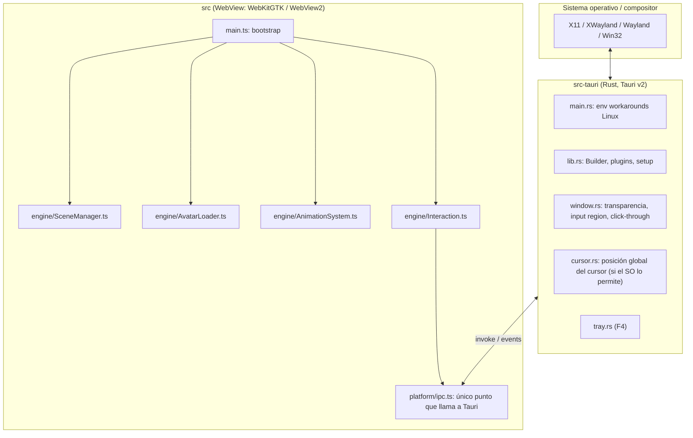

# Arquitectura

## Vista general



## Principios

1. **El frontend no sabe de Tauri** salvo en `src/platform/`. El motor (`src/engine/`)
   es TS puro + Three.js → testeable y reutilizable (p. ej. en un navegador para debug).
2. **Rust hace solo lo que el WebView no puede:** ventana, input region, cursor global,
   tray, archivos, autostart. Nada de lógica de animación en Rust.
3. **Un loop de render, un reloj.** `SceneManager` posee el `requestAnimationFrame` y
   reparte `delta` a los sistemas (`update(dt)`), con FPS cap configurable.
4. **Degradación elegante por plataforma:** cada capacidad se consulta
   (`get_platform_caps`) y el frontend se adapta (p. ej. sin cursor global en Wayland
   nativo → LookAt solo cuando el cursor está sobre la ventana).

## Estructura objetivo

```text
src/
├── main.ts                    # bootstrap: crea SceneManager, carga avatar, registra sistemas
├── styles/app.css             # html/body transparentes, sin scroll
├── engine/
│   ├── SceneManager.ts        # renderer (alpha), cámara, luces, loop, resize
│   ├── AvatarLoader.ts        # GLTFLoader + VRMLoaderPlugin, normalización
│   ├── AnimationSystem.ts     # idle, blink, vrm.update(dt)
│   ├── Interaction.ts         # hit-test, drag, lookAt, coordinación click-through
│   └── types.ts               # interfaces System { update(dt): void; dispose(): void }
└── platform/
    ├── ipc.ts                 # wrappers tipados de invoke/listen
    ├── caps.ts                # capacidades de plataforma
    ├── drag.ts                # drag de ventana nativo
    └── input-region.ts        # regiones interactivas y click-through dinámico
src-tauri/
├── tauri.conf.json
├── capabilities/default.json  # permisos mínimos (Tauri v2 ACL)
└── src/
    ├── main.rs                # env vars Linux y llamada a lib::run()
    ├── lib.rs                 # Builder, plugins, invoke_handler
    ├── input_region.rs        # comando set_input_region y cairo::Region (Linux)
    ├── window.rs              # comandos de ventana
    ├── cursor.rs              # polling del cursor global
    └── platform.rs            # detección X11/Wayland/Windows → PlatformCaps
```

## Contrato IPC

Toda comunicación `invoke` / `listen` / `emit` pasa por `src/platform/ipc.ts`. Cambiar este contrato requiere
actualizar esta tabla en el mismo PR (commit con `!` si rompe compatibilidad).

### Comandos (`invoke` JS→Rust)

| Comando                           | Payload                                                                           | Respuesta                                    | Módulo Rust          |
| --------------------------------- | --------------------------------------------------------------------------------- | -------------------------------------------- | -------------------- |
| `get_platform_caps`               | —                                                                                 | `PlatformCaps`                               | `platform.rs`        |
| `set_input_region`                | `{ rects: Rect[] \| null }` (px lógicos GTK, relativos a ventana; `null` = reset) | `()`                                         | `input_region.rs`    |
| `set_window_desktop_size`         | `{ width: number, height: number }` (px lógicos)                                  | `()`                                         | `platform.rs`        |
| `set_window_desktop_position`     | `{ x: number, y: number }` (px de escritorio)                                     | `()`                                         | `platform.rs`        |
| `get_window_cursor_position`      | —                                                                                 | `[number, number] \| null`                   | `platform.rs`        |
| `get_active_window_rect`          | —                                                                                 | `[number, number, number, number] \| null`   | `platform.rs`        |
| `set_focus_metadata_mode`         | `{ mode: 0 \| 1 \| 2 }`                                                           | `()`                                         | `cursor_bridge.rs`   |
| `get_window_focus_metadata`       | —                                                                                 | `{ appId?: string, title?: string } \| null` | `cursor_bridge.rs`   |
| `open_settings_window`            | —                                                                                 | `()`                                         | `settings_window.rs` |
| `start_local_bridge`              | —                                                                                 | `BridgeStatus`                               | `local_bridge.rs`    |
| `stop_local_bridge`               | —                                                                                 | `BridgeStatus`                               | `local_bridge.rs`    |
| `get_bridge_status`               | —                                                                                 | `BridgeStatus`                               | `local_bridge.rs`    |
| `regenerate_bridge_token`         | —                                                                                 | `BridgeStatus`                               | `local_bridge.rs`    |
| `subscribe_bridge_inbound`        | `{ channel: Channel<BridgeInboundPayload> }` (`InvokeResponseBody::Raw \| Json`)  | `()`                                         | `local_bridge.rs`    |
| `send_bridge_event`               | `{ message: BridgeOutboundMessage }`                                              | `()`                                         | `local_bridge.rs`    |
| `list_plugins`                    | —                                                                                 | `PluginInfo[]`                               | `plugins.rs`         |
| `list_registered_animations`      | —                                                                                 | `RegisteredAnimation[]`                      | `plugins.rs`         |
| `register_animation`              | `{ id: string, path: string, label?: string \| null }`                            | `RegisteredAnimation`                        | `plugins.rs`         |
| `unregister_animation`            | `{ id: string }`                                                                  | `boolean`                                    | `plugins.rs`         |
| `read_registered_animation_bytes` | `{ id: string }`                                                                  | `ArrayBuffer` (binario `.vrma`)              | `plugins.rs`         |

### Eventos (Tauri `emit` / `listen`)

| Dirección | Evento                       | Payload               | Origen / Uso                                           |
| --------- | ---------------------------- | --------------------- | ------------------------------------------------------ |
| Rust→JS   | `tray-request-load-avatar`   | `()`                  | Menú del tray: abrir selector `.vrm`                   |
| Rust→JS   | `tray-request-clear-avatar`  | `()`                  | Menú del tray: quitar avatar                           |
| Rust→JS   | `tray-request-load-vrma`     | `()`                  | Menú del tray: abrir selector `.vrma`                  |
| Rust→JS   | `tray-request-stop-vrma`     | `()`                  | Menú del tray: detener animación `.vrma`               |
| Rust→JS   | `tray-autostart-changed`     | `boolean`             | Menú del tray: sincronizar autostart en store          |
| Rust→JS   | `tray-visibility-changed`    | `boolean`             | Menú del tray: mostrar/ocultar (`PowerSaveController`) |
| Rust→JS   | `cursor-bridge-window-focus` | `WindowFocusMetadata` | `cursor_bridge.rs`: cambio de ventana activa (`T-609`) |
| Rust→JS   | `settings-window-visibility` | `boolean`             | `settings_window.rs`: estado de ventana Ajustes        |
| JS↔JS     | `settings-updated`           | `AppConfig`           | `SettingsPanel` → `main.ts`: cambios en vivo           |

```ts
type PlatformCaps = {
  os: "linux" | "windows" | "macos";
  displayServer: "x11" | "xwayland" | "wayland" | "win32" | "quartz";
  globalCursor: boolean; // ¿podemos leer el cursor fuera de la ventana?
  inputRegion: boolean; // ¿click-through parcial por región?
  alwaysOnTop: boolean; // ¿el compositor lo respeta?
  setPosition: boolean; // ¿podemos mover la ventana programáticamente?
  localBridge: boolean; // ¿puente WebSocket local disponible en esta plataforma?
  plugins: boolean; // ¿runtime de plugins aislados disponible en esta plataforma?
};
type Rect = { x: number; y: number; w: number; h: number };
type BridgeStatus = {
  running: boolean;
  port: number | null;
  bridgeFilePath: string | null;
  token: string | null;
  connectedClients: number;
  maxClients: number;
};
type BridgeInboundPayload =
  | ArrayBuffer // tramas binarias `DSK1` para `speakChunk` (PCM)
  | { kind: "command"; clientId: string; envelope: unknown }
  | { kind: "clientDisconnected"; clientId: string };
type BridgeOutboundMessage = {
  targetClientIds?: string[];
  payload: unknown;
};
```

Movimiento de ventana: usar la API JS `getCurrentWindow().startDragging()` (funciona en
Wayland porque delega al compositor). `setPosition` solo si `caps.setPosition`.

## Matriz de capacidades validada (Spike T-103)

| Capacidad                | X11 / XWayland                         | Wayland nativo (GNOME)                        | Wayland nativo (KDE)                          | Windows          |
| ------------------------ | -------------------------------------- | --------------------------------------------- | --------------------------------------------- | ---------------- |
| Transparencia            | ✅ (con compositor)                    | ✅                                            | ✅                                            | ✅               |
| Always-on-top            | ✅                                     | ❌ (solo el usuario)                          | ⚠️ (reglas de KWin)                           | ✅               |
| Cursor global            | ✅ (~150 µs/query, 0.45% CPU a 30 Hz)  | ❌ (bloqueado por protocolo, Tao retorna 0,0) | ❌ (bloqueado por protocolo, Tao retorna 0,0) | ✅               |
| Input region             | ✅ (XShape, <5 µs/update, 0% CPU cont) | ✅ (wl_surface, <5 µs/update, 0% CPU cont)    | ✅ (wl_surface, <5 µs/update, 0% CPU cont)    | ⚠️ (por validar) |
| Mover ventana por código | ✅                                     | ❌ (`startDragging` sí)                       | ❌ (`startDragging` sí)                       | ✅               |

> **Evidencia T-103:** Medido en Fedora 44 (GNOME 48, Wayland + XWayland, Intel HD 630). Input region aplica sobre `cairo::Region` + `gtk_widget_input_shape_combine_region` tanto en XWayland (vía XShape) como en Wayland nativo (vía `wl_surface.set_input_region`), requiriendo menos de 5 microsegundos por lote de 1 a 100 rectángulos y consumo nulo de CPU en reposo. El cursor global está completamente bloqueado en Wayland nativo por arquitectura de seguridad, descartando el polling de cursor como solución multiplataforma.

## Decisiones

Ver [docs/adr/](adr/). Resumen:

- [ADR-0001](adr/0001-tauri-v2-threejs-vrm.md) — Tauri v2 + Three.js + three-vrm.
- [ADR-0002](adr/0002-click-through-strategy.md) — Estrategia de click-through (**aceptada** en T-103).
- [ADR-0003](adr/0003-xwayland-default-on-linux.md) — XWayland por defecto en Linux (**propuesta**).
- [ADR-0004](adr/0004-vanilla-ts-settings-window.md) — Ventana de ajustes en TypeScript vanilla (**aceptada**).
- [ADR-0005](adr/0005-wayland-global-cursor-bridge.md) — Puente D-Bus multi-compositor (`org.deskumi.CursorBridge`) para cursor global en Wayland (**aceptada**).
- [ADR-0006](adr/0006-plugins-and-local-ws-bridge.md) — Arquitectura de plugins aislados (`plugin://` + `<iframe sandbox="allow-scripts">`), puente WebSocket local (`127.0.0.1`), `Channel` binario, audio/lip-sync, CSP y presupuesto RAM (**aceptada** en T-600).
- [LIMITATIONS.md](LIMITATIONS.md) — Registro de limitaciones técnicas, workarounds activos y pendientes por resolver.
