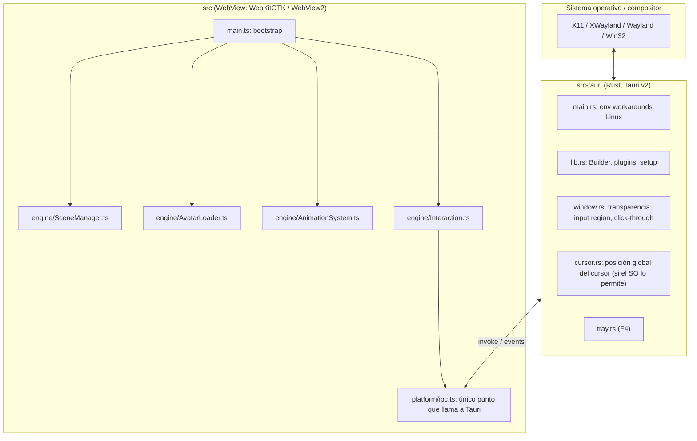

# Arquitectura

## Vista general


## Principios
1. **El frontend no sabe de Tauri** salvo en `src/platform/`. El motor (`src/engine/`)
   es TS puro + Three.js → testeable y reutilizable (p. ej. en un navegador para debug).
2. **Rust hace solo lo que el WebView no puede:** ventana, input region, cursor global,
   tray, archivos, autostart. Nada de lógica de animación en Rust.
3. **Un loop de render, un reloj.** `SceneManager` posee el `requestAnimationFrame` y
   reparte `delta` a los sistemas (`update(dt)`), con FPS cap configurable.
4. **Degradación elegante por plataforma:** cada capacidad se consulta
   (`get_platform_caps`) y el frontend se adapta (p. ej. sin cursor global en Wayland
   nativo → LookAt solo cuando el cursor está sobre la ventana).

## Estructura objetivo
```text
src/
├── main.ts                    # bootstrap: crea SceneManager, carga avatar, registra sistemas
├── styles/app.css             # html/body transparentes, sin scroll
├── engine/
│   ├── SceneManager.ts        # renderer (alpha), cámara, luces, loop, resize
│   ├── AvatarLoader.ts        # GLTFLoader + VRMLoaderPlugin, normalización
│   ├── AnimationSystem.ts     # idle, blink, vrm.update(dt)
│   ├── Interaction.ts         # hit-test, drag, lookAt, coordinación click-through
│   └── types.ts               # interfaces System { update(dt): void; dispose(): void }
└── platform/
    ├── ipc.ts                 # wrappers tipados de invoke/listen
    └── caps.ts                # capacidades de plataforma
src-tauri/
├── tauri.conf.json
├── capabilities/default.json  # permisos mínimos (Tauri v2 ACL)
└── src/
    ├── main.rs                # env vars Linux y llamada a lib::run()
    ├── lib.rs                 # Builder, plugins, invoke_handler
    ├── window.rs              # comandos de ventana
    ├── cursor.rs              # polling del cursor global
    └── platform.rs            # detección X11/Wayland/Windows → PlatformCaps
```

## Contrato IPC
Toda comunicación pasa por `src/platform/ipc.ts`. Cambiar este contrato requiere
actualizar esta tabla en el mismo PR (commit con `!` si rompe compatibilidad).

| Dirección | Nombre | Payload | Respuesta | Fase |
| --- | --- | --- | --- | --- |
| JS→Rust | `get_platform_caps` | — | `PlatformCaps` | F1 |
| JS→Rust | `set_click_through` | `{ ignore: bool }` | `()` | F1 |
| JS→Rust | `set_input_region` | `{ rects: Rect[] }` (px físicos, relativos a la ventana) | `()` | F1 (si ADR-0002 lo adopta) |
| JS→Rust | `start_cursor_tracking` / `stop_cursor_tracking` | `{ hz: number }` | `()` | F3 |
| Rust→JS (evento) | `cursor://moved` | `{ x, y, inside: bool }` (px físicos, relativos a la ventana) | — | F3 |

```ts
type PlatformCaps = {
  os: "linux" | "windows" | "macos";
  displayServer: "x11" | "xwayland" | "wayland" | "win32" | "quartz";
  globalCursor: boolean;   // ¿podemos leer el cursor fuera de la ventana?
  inputRegion: boolean;    // ¿click-through parcial por región?
  alwaysOnTop: boolean;    // ¿el compositor lo respeta?
  setPosition: boolean;    // ¿podemos mover la ventana programáticamente?
};
type Rect = { x: number; y: number; w: number; h: number };
```

Movimiento de ventana: usar la API JS `getCurrentWindow().startDragging()` (funciona en
Wayland porque delega al compositor). `setPosition` solo si `caps.setPosition`.

## Matriz de capacidades esperada (validar en T-103)
| Capacidad | X11 / XWayland | Wayland nativo (GNOME) | Wayland nativo (KDE) | Windows |
| --- | --- | --- | --- | --- |
| Transparencia | ✅ (con compositor) | ✅ | ✅ | ✅ |
| Always-on-top | ✅ | ❌ (solo el usuario) | ⚠️ (reglas de KWin) | ✅ |
| Cursor global | ✅ | ❌ | ❌ | ✅ |
| Input region | ✅ (XShape) | ✅ (wl_surface input region) | ✅ | ⚠️ (por validar) |
| Mover ventana por código | ✅ | ❌ (`startDragging` sí) | ❌ (`startDragging` sí) | ✅ |

## Decisiones
Ver [docs/adr/](adr/). Resumen:
- [ADR-0001](adr/0001-tauri-v2-threejs-vrm.md) — Tauri v2 + Three.js + three-vrm.
- [ADR-0002](adr/0002-click-through-strategy.md) — Estrategia de click-through (**propuesta**, la cierra T-103).
- [ADR-0003](adr/0003-xwayland-default-on-linux.md) — XWayland por defecto en Linux (**propuesta**).
