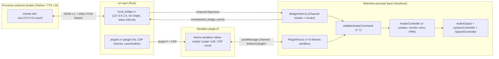

# Guía de Plugins y Puente WebSocket Local (`v: 1`)

Deskumi ofrece dos vías desacopladas para extender el comportamiento del avatar
y conectarlo con agentes de IA, motores de síntesis de voz (TTS) o herramientas
locales:

1. **Plugins locales aislados (`plugin://`):** scripts HTML/JS instalados en disco
   que corren dentro de `<iframe sandbox="allow-scripts">` sin acceso a Tauri,
   red ni DOM principal, comunicándose únicamente por `postMessage`.
2. **Puente WebSocket local (`127.0.0.1`):** servidor loopback autenticado por
   token efímero (`bridge.json`) para procesos externos (Python, Rust, Node,
   motores TTS/RVC, clientes LLM) con soporte para audio PCM binario en tiempo
   real (`DSK1`).

> **Alcance de plataforma (F6):** el runtime de plugins aislados y el puente
> WebSocket local están orientados y validados **Linux-first** (ver
> [`LIMITATIONS.md`](LIMITATIONS.md#l-06-alcance-linux-first-para-fase-6-plugins-habla-y-puente-websocket-local)).
> En Windows su disponibilidad y paridad quedan pendientes para validación en E4.

---

## Arquitectura general



Los detalles de decisión arquitectónica y medición empírica en WebKitGTK están
congelados en [ADR-0006](adr/0006-plugins-and-local-ws-bridge.md).

---

## Licencias (Núcleo GPL-3.0, Ejemplos MIT y Bancos de Voz)

- **Núcleo de Deskumi:** licenciado bajo **GPL-3.0-or-later**
  ([`LICENSE`](../LICENSE)).
- **Ejemplos oficiales bajo [`examples/`](../examples/):** el cliente Python
  ([`examples/bridge/echo_tts_bridge.py`](../examples/bridge/echo_tts_bridge.py))
  y el plugin de ejemplo
  ([`examples/plugins/hello-companion/`](../examples/plugins/hello-companion/)) se
  publican explícitamente bajo la **licencia permisiva MIT**
  ([`examples/LICENSE`](../examples/LICENSE)). Puedes copiarlos, modificarlos e
  integrarlos en tus propios scripts o servicios externos sin heredar GPLv3.
- **Bancos de voz y modelos de terceros:** cada motor y voz externa tiene su
  propia licencia independiente de Deskumi. Por ejemplo, **Piapro Character
  License** (Hatsune Miku, etc.) y los términos de **Twin Drill** (Kasane Teto),
  así como muchos locutores de **VOICEVOX** y pesos de **GPT-SoVITS / RVC**,
  prohíben el uso comercial, el entrenamiento derivado o ciertas redistribuciones.
  Verifica siempre los términos del voicebank antes de redistribuir audio o
  modelos.

---

## 1. Plugins locales aislados (`plugin://`)

### 1.1 Ubicación en disco

Deskumi descubre subdirectorios `<id>/manifest.json` dentro de `$APPDATA/plugins/`:

- **Linux:** `"${XDG_DATA_HOME:-$HOME/.local/share}/dev.crivera.deskumi/plugins/<id>/"`
- **Windows (futuro E4):** `%APPDATA%\dev.crivera.deskumi\plugins\<id>\`

Cada plugin reside en su propia carpeta cuyo nombre debe coincidir exactamente
con el campo `"id"` de `manifest.json`. Los directorios cuyo nombre empieza por
`.` se ignoran.

### 1.2 Manifiesto (`manifest.json`)

Esquema formal: [`docs/schemas/plugin-manifest.schema.json`](schemas/plugin-manifest.schema.json).

```json
{
  "id": "hello-companion",
  "name": "Hello Companion",
  "version": "0.1.0",
  "description": "Reacts to avatar clicks with expressions and speech bubbles.",
  "entry": "index.html",
  "permissions": ["avatar:expression", "avatar:speak", "avatar:events"],
  "animations": [
    {
      "id": "wave",
      "path": "animations/wave.vrma",
      "label": "Wave greeting"
    }
  ]
}
```

Reglas validadas en [`src-tauri/src/plugins.rs`](../src-tauri/src/plugins.rs):

- `manifest.json`: tamaño máximo **256 KiB**.
- `id`: 1–64 caracteres ASCII minúsculas `[a-z0-9._-]`, empezando y terminando
  por `[a-z0-9]`, sin `..`, e idéntico al nombre del directorio padre.
- `name`: 1–128 caracteres (no vacío, sin caracteres de control).
- `version`: 1–64 caracteres (no vacío, sin caracteres de control).
- `description` (opcional): hasta 500 caracteres.
- `entry`: subruta relativa a `.html` o `.htm` dentro del directorio del plugin
  (sin `/`, `\`, `:`, `.`, `..`, `?`, `#` ni symlinks que escapen de la raíz).
- `permissions` (opcional, por defecto `[]`): máximo **16** entradas dentro de
  los 8 scopes oficiales. Ningún permiso se concede automáticamente: el usuario
  debe marcar cada casilla en **Ajustes → Plugins aislados y animaciones**.
- `animations` (opcional, por defecto `[]`): máximo **64** entradas. Cada `id`
  (1–128 caracteres `[A-Za-z0-9._:-]`, inicio alfanumérico, sin `..`) apunta a un
  archivo `.vrma` dentro del plugin (≤ **32 MiB**).

### 1.3 Frontera de seguridad y CSP estricta

Todo archivo servido por `plugin://<pluginId>/...` recibe estas cabeceras desde
Rust:

```http
Content-Security-Policy: default-src 'none'; script-src plugin://<pluginId>; worker-src 'none'; connect-src 'none'
Cache-Control: no-store
X-Content-Type-Options: nosniff
```

Y el iframe se monta en `PluginHost` con:

```html
<iframe
  sandbox="allow-scripts"
  src="plugin://hello-companion/index.html"
></iframe>
```

Consecuencias prácticas para autores:

- **Sin `allow-same-origin`:** `window.origin` es `"null"`. No existe acceso a
  `window.parent.document`, `window.__TAURI__`, `window.__TAURI_INTERNALS__`,
  `@tauri-apps/*` ni `plugin-fs`.
- **Sin scripts ni estilos inline:** `<script>...</script>`, manejadores
  `onclick="..."` y `<style>` inline quedan bloqueados por `default-src 'none'`.
  Usa siempre etiquetas externas relativas al propio plugin, por ejemplo:

  ```html
  <!doctype html>
  <html lang="en">
    <head>
      <meta charset="utf-8" />
      <title>My Plugin</title>
    </head>
    <body>
      <script src="./main.js"></script>
    </body>
  </html>
  ```

- **Sin red ni Workers:** `fetch`, `XMLHttpRequest`, `WebSocket`, `import()`
  remoto y `new Worker(blob)` fallan sin emitir tráfico TCP.
- **Límite de concurrencia y CPU:** máximo **3 plugins activos**
  simultáneamente (`MAX_ACTIVE_PLUGINS = 3`). Como los iframes comparten el
  proceso WebKit, programa los plugins orientados a eventos y evita bucles
  síncronos bloqueantes.

### 1.4 Ciclo de vida `postMessage` (`channel: "deskumi:plugin"`)

Toda comunicación entre el iframe del plugin y Deskumi usa el canal
`"deskumi:plugin"` y versión `v: 1`.

**1. Recepción en el plugin (`Host → Plugin`):**

Valida siempre `event.source === window.parent`, `data.channel === "deskumi:plugin"`
y `data.v === 1`:

```js
window.addEventListener("message", (event) => {
  if (event.source !== window.parent) return;
  const data = event.data;
  if (!data || data.channel !== "deskumi:plugin" || data.v !== 1) return;

  if (data.type === "init") {
    // data.pluginId, data.scopes, data.expressions, data.animations
    // Suscríbete a los eventos que necesites enviando `hello`:
    window.parent.postMessage(
      {
        channel: "deskumi:plugin",
        pluginId: data.pluginId,
        v: 1,
        id: "hello-1",
        cmd: {
          type: "hello",
          clientName: "my-plugin",
          clientVersion: "0.1.0",
          events: ["click"]
        }
      },
      "*"
    );
  }
});
```

Mensajes que el host envía hacia el plugin:

- **`init`**: entregado al cargar el iframe. Incluye `scopes` aprobados para ese
  plugin, `expressions` disponibles en el modelo `.vrm` actual y `animations`
  registradas.
- **`permissionsChanged`**: enviado en vivo si el usuario activa o desactiva
  casillas de permisos en Ajustes (`scopes: string[]`).
- **`hello` / `ack` / `error`**: respuesta correlacionada mediante `ref` (igual al
  `id` enviado en el comando).
- **Eventos suscritos:** llegan con `{ channel: "deskumi:plugin", pluginId, v: 1, type, ... }`
  únicamente si el plugin los pidió en `hello.events` y posee el permiso
  correspondiente (`avatar:events` o `desktop:events`).

**2. Envío de comandos (`Plugin → Host`):**

```js
window.parent.postMessage(
  {
    channel: "deskumi:plugin",
    pluginId: "hello-companion",
    v: 1,
    id: "say-1",
    cmd: {
      type: "say",
      text: "Hello from sandbox!",
      durationMs: 2200,
      policy: "interrupt"
    }
  },
  "*"
);
```

Consulta el ejemplo completo y funcional en
[`examples/plugins/hello-companion/`](../examples/plugins/hello-companion/).

---

## 2. Puente WebSocket local (`127.0.0.1`)

El puente WebSocket permanece **apagado por defecto** (0 sockets abiertos, 0
tareas Tokio, 0 MB extra de RAM). Actívalo en **Ajustes → Puente WebSocket
local**.

### 2.1 Archivo de descubrimiento `bridge.json`

Al arrancar el puente, Rust abre un listener en `127.0.0.1:0` (puerto efímero),
genera un token CSPRNG de 256 bits (64 caracteres hexadecimales) y escribe
atómicamente (`create_new` + modo `0600` + `rename`) el archivo `bridge.json` en
un directorio `0700`:

1. `$XDG_RUNTIME_DIR/deskumi/bridge.json` _(prioritario en Linux; tmpfs de sesión)_
2. `$APPDATA/deskumi/bridge.json`
3. `$XDG_DATA_HOME/deskumi/bridge.json`
4. `$HOME/.local/share/deskumi/bridge.json`

Formato de `bridge.json`:

```json
{
  "version": 1,
  "pid": 18492,
  "port": 43821,
  "token": "9f8e7d6c..."
}
```

- Al detener el puente o cerrar Deskumi (`RunEvent::Exit`), el archivo se
  elimina automáticamente.
- El campo `pid` permite a clientes externos verificar si el proceso sigue vivo
  en caso de terminación abrupta (`SIGKILL`).

### 2.2 Handshake, seguridad anti-CSWSH y modelo de amenazas

1. Conecta por TCP plano a `ws://127.0.0.1:<port>` (sin TLS).
2. **No envíes cabecera HTTP `Origin`:** `local_bridge.rs` rechaza con `403 Forbidden`
   cualquier upgrade HTTP que incluya `Origin` para bloquear ataques
   Cross-Site WebSocket Hijacking desde navegadores web.
3. **Timeouts:** el handshake HTTP expira a los **2 s**; una vez conectado,
   debes enviar el primer mensaje JSON `hello` con `"token"` en **≤ 2 s**.
4. **Primer mensaje obligatorio (`hello`):**

```json
{
  "v": 1,
  "id": "hello-1",
  "cmd": {
    "type": "hello",
    "token": "<token leído de bridge.json>",
    "clientName": "my-tts-client",
    "clientVersion": "0.1.0",
    "events": ["speechStart", "speechEnd"]
  }
}
```

5. El servidor compara el token en tiempo constante. Si el token es inválido o
   falta, responde `error` (`code: "forbidden"`) y cierra el socket.
6. Al pulsar **Regenerar token** en Ajustes, Deskumi rota `bridge.json` y cierra
   todos los clientes existentes (`"Token rotated"`).

> **Modelo de amenazas:** el puente protege frente a páginas web (rechazo de
> `Origin`), red externa (`127.0.0.1` exclusivo) y otros usuarios/aplicaciones en
> sandbox sin acceso a `$XDG_RUNTIME_DIR` (`0700`/`0600`). **No** aísla entre
> procesos no sandboxed ejecutados por el mismo usuario del SO: cualquier proceso
> local del mismo usuario que pueda leer `bridge.json` obtiene los scopes
> activos configurados en Ajustes.

### 2.3 Protocolo binario `DSK1` para `speakChunk`

Para streaming de voz con baja latencia sin inflar +33 % en base64 ni disparar
`eval()` en el WebView, los chunks PCM se envían como **tramas WebSocket
binarias (`opcode 0x2`)** con cabecera big-endian de 12 bytes + `streamId` + PCM:

| Offset (bytes)  | Tamaño | Tipo / Valor     | Descripción                                                                 |
| --------------- | ------ | ---------------- | --------------------------------------------------------------------------- |
| `0..4`          | 4 B    | ASCII `"DSK1"`   | Magic header (`0x44 0x53 0x4B 0x31`)                                        |
| `4`             | 1 B    | `u8 = 0x01`      | Kind (`0x01` = `speakChunk`)                                                |
| `5`             | 1 B    | `u8 = 0x00`      | Flags reservadas (debe ser `0`)                                             |
| `6..8`          | 2 B    | `u16` Big-Endian | `streamIdLen` en bytes (`1..=128`)                                          |
| `8..12`         | 4 B    | `u32` Big-Endian | `sampleRate` en Hz (`0` = heredar `speakStart.sampleRate`, o `8000..48000`) |
| `12 .. 12+len`  | `len`  | UTF-8            | `streamId` no vacío (debe pertenecer al cliente que abrió `speakStart`)     |
| `12+len .. fin` | ≥ 1 B  | bytes crudos     | Muestras PCM (`pcm_s16le` o `pcm_f32le` según `speakStart`)                 |

Ejemplo en Python (`struct.pack`):

```python
def pack_speak_chunk(stream_id: str, sample_rate: int, pcm: bytes) -> bytes:
    sid = stream_id.encode("utf-8")
    return struct.pack(">4sBBHI", b"DSK1", 1, 0, len(sid), sample_rate) + sid + pcm
```

- Límite máximo por trama binaria: **5 MB** (`5 * 1024 * 1024` bytes).
- Tasa binaria permitida: **~512 KB/s** por cliente WS.
- Si una trama binaria es válida, el camino normal no emite `ack` por chunk
  para evitar tráfico de vuelta a 10–50 Hz; solo responde `error` si falla
  validación, tasa o capacidad.
- Para sincronizar `visemes` junto al stream o si prefieres enviar texto/visemas
  puntuales, también puedes enviar `speakChunk` JSON con `visemes` y/o
  `pcmBase64`.
- Referencia completa sin dependencias externas:
  [`examples/bridge/echo_tts_bridge.py`](../examples/bridge/echo_tts_bridge.py).

---

## 3. Contrato `v: 1`, canales y límites

Esquemas formales JSON Schema (Draft 2020-12):

- Comandos: [`docs/schemas/avatar-command.schema.json`](schemas/avatar-command.schema.json)
- Eventos: [`docs/schemas/avatar-event.schema.json`](schemas/avatar-event.schema.json)
- Manifiesto de plugin: [`docs/schemas/plugin-manifest.schema.json`](schemas/plugin-manifest.schema.json)

### 3.1 Comandos y los 4 canales arbitrados

`AvatarController` es el único escritor del modelo VRM antes de `vrm.update(dt)` y
arbitra cuatro canales independientes según la propiedad `policy` del comando
(`"interrupt"` | `"queue"` | `"drop"`):

| Canal        | Comandos                                                                              | Política por defecto | Notas                                                                                                           |
| ------------ | ------------------------------------------------------------------------------------- | -------------------- | --------------------------------------------------------------------------------------------------------------- |
| `mouth`      | `say`, `speak`, `speakStart`, `speakChunk`, `speakEnd`, `speakCancel`, `stopSpeaking` | `queue`              | Unifica burbuja de diálogo (`say`), audio base64 (`speak`) y streams PCM (`speakStart`).                        |
| `expression` | `expression`, `reaction`                                                              | `interrupt`          | `expression` usa nombres del VRM (`hello.expressions`); `reaction` usa `happy`, `surprised`, `relaxed`, `wink`. |
| `pose`       | `animation`                                                                           | `interrupt`          | Solo acepta IDs registrados (`vrma`), nunca rutas de disco.                                                     |
| `lookAt`     | `lookAt`                                                                              | `interrupt`          | Coordenadas `x`, `y` en `[-1, 1]` relativas al centro del viewport (`durationMs` por defecto `3000`).           |

Comportamientos clave de `AvatarController` y audio:

- **Sin `audio.url` en v1:** `speak.audio` solo acepta `{ base64, mime, sampleRate? }`
  con `mime` `"audio/*"`; pasar `audio.url` se rechaza con `error: invalid`.
- **Visemas y respaldo RMS:** los visemas válidos son `aa`, `ih`, `ou`, `ee`,
  `oh` y `neutral`. El visema `neutral` cierra la boca sin intentar escribir un
  preset llamado `"neutral"`. Si no se envían `visemes`, `LipSyncController`
  calcula automáticamente apertura (`aa`) por amplitud RMS sobre el PCM en
  memoria, sincronizado estrictamente contra `AudioContext.currentTime`.
- **Audio en frío y reposo:** `AudioOutput` crea el `AudioContext` de manera
  perezosa en el primer `speak`/`speakStart`, invoca `resume()` sin gesto de
  usuario, usa 120 ms de pre-buffer y llama `suspend()` tras ~4 s de inactividad
  para liberar PipeWire/PulseAudio.
- **Ventana oculta:** cuando Deskumi está oculto desde la bandeja, todo comando
  (salvo `hello`) responde `error: hidden` y el habla activa finaliza con
  `speechEnd` (`reason: "hidden"`).

### 3.2 Respuestas (`hello`, `ack`, `error`)

Todo comando (salvo chunks binarios válidos) recibe una respuesta con `v: 1` y
`ref` opcional coincidente con `id`:

- **Respuesta a `hello`:**
  ```json
  {
    "v": 1,
    "type": "hello",
    "ref": "hello-1",
    "protocolVersion": 1,
    "limits": {
      "maxTextLength": 500,
      "maxVisemes": 256,
      "minSampleRate": 8000,
      "maxSampleRate": 48000,
      "maxDurationMs": 30000,
      "maxAudioBytes": 5242880,
      "maxStreamIdLength": 128,
      "maxIdLength": 128
    },
    "scopes": ["avatar:speak", "avatar:expression"],
    "expressions": ["happy", "angry", "sad", "relaxed", "surprised"],
    "animations": ["wave"],
    "subscribedEvents": ["speechStart", "speechEnd"]
  }
  ```
- **`ack`:** `{ "v": 1, "type": "ack", "ref": "say-1" }`
- **`error`:** `{ "v": 1, "type": "error", "ref": "expr-1", "code": "unknown_expression", "message": "..." }`

Códigos de error cerrados:

| Código               | Significado                                                                               |
| -------------------- | ----------------------------------------------------------------------------------------- |
| `invalid`            | Sobre malformado, versión distinta de `1`, campo fuera de rango o `streamId` desconocido. |
| `rate_limited`       | Excedidos `30 cmd/s` de control o `~512 KB/s` de PCM binario.                             |
| `too_large`          | Payload > `5 MB`, buffer de stream > `10 MB` o campos que superan tope máximo.            |
| `forbidden`          | Falta el scope necesario, token inválido/ausente o stream ajeno al cliente.               |
| `busy`               | Canal ocupado con `policy: "drop"`, cola llena (`8` ítems) o runtime no adjunto.          |
| `hidden`             | La ventana principal del avatar está oculta.                                              |
| `unknown_expression` | `expression.name` no existe en el `expressionMap` del `.vrm` cargado.                     |
| `unknown_animation`  | `animation.vrma` no existe en el registro lógico de animaciones.                          |

### 3.3 Límites operativos fijados (ADR-0006)

`validateAvatarCommand` rechaza explícitamente cualquier valor fuera de rango;
**nunca recorta en silencio**.

| Parámetro / Límite                            | Valor v1               | Donde se aplica                                       |
| --------------------------------------------- | ---------------------- | ----------------------------------------------------- |
| Plugins activos simultáneos (`maxWorkers`)    | `3`                    | `PluginHost.ts` / Ajustes                             |
| Clientes WebSocket simultáneos (`maxClients`) | `4` (HTTP `503` extra) | `local_bridge.rs`                                     |
| Mensaje WS / `audio.base64` / chunk máximo    | `5 MB` (`5242880` B)   | `local_bridge.rs` + `AvatarCommandSchema.ts`          |
| Cola de habla / canal (`maxQueueSize`)        | `8` ítems              | `SpeechController.ts` / `AvatarControllerDispatch.ts` |
| Buffer PCM acumulado por stream               | `10 MB` (`10485760` B) | `SpeechTypes.ts`                                      |
| Timeout de inactividad en stream              | `5 s` (`5000` ms)      | `SpeechTypes.ts`                                      |
| Tasa de comandos de control                   | `30 cmd/s`             | `local_bridge.rs` y `PluginHostBridge.ts`             |
| Tasa de PCM binario WS                        | `~512 KB/s`            | `local_bridge.rs`                                     |
| Longitud de `text` (`say`/`speak`)            | `500` caracteres       | `AvatarCommandSchema.ts`                              |
| Keyframes en `visemes`                        | `256`                  | `AvatarCommandSchema.ts`                              |
| `sampleRate` PCM                              | `8000..48000` Hz       | `AvatarCommandSchema.ts` / `local_bridge.rs`          |
| `durationMs` / `fadeInMs`                     | `0..30000` ms          | `AvatarCommandSchema.ts`                              |
| `id` / `streamId`                             | `1..128` caracteres    | `AvatarCommandSchema.ts`                              |
| `vrma` (ID lógico)                            | `1..256` caracteres    | `AvatarCommandValidator.ts`                           |

---

## 4. Permisos (`scopes`), `windowFocus` y registro `.vrma`

### 4.1 Tabla de scopes

| Scope                 | Comandos / Eventos autorizados                                            | Default WS Bridge | Default Plugins            |
| --------------------- | ------------------------------------------------------------------------- | ----------------- | -------------------------- |
| `avatar:speak`        | `speak`, `speakStart`, `speakChunk`, `speakEnd`, `speakCancel`, `say`     | Activado          | Requiere aprobación manual |
| `avatar:interrupt`    | `stopSpeaking`                                                            | Activado          | Requiere aprobación manual |
| `avatar:expression`   | `expression`, `reaction`                                                  | Activado          | Requiere aprobación manual |
| `avatar:animation`    | `animation`                                                               | Activado          | Requiere aprobación manual |
| `avatar:lookAt`       | `lookAt`                                                                  | Activado          | Requiere aprobación manual |
| `avatar:events`       | Eventos `click`, `speechStart`, `speechEnd`, `idleChange`, `avatarChange` | Activado          | Requiere aprobación manual |
| `desktop:events`      | Evento `windowFocus` con `appId` únicamente                               | **Desactivado**   | Requiere aprobación manual |
| `desktop:windowTitle` | Añade campo `title` a `windowFocus` (requiere también `desktop:events`)   | **Desactivado**   | Requiere aprobación manual |

### 4.2 Privacidad en `windowFocus` (`desktop:events` vs `desktop:windowTitle`)

En Wayland ningún proceso ordinario puede leer títulos de ventanas ajenas. Por
seguridad, Deskumi divide `windowFocus` en dos permisos y coordina al compositor
vía `org.deskumi.CursorBridge` (`FocusMetadataMode`):

- **`0` (sin `desktop:events`):** la extensión de GNOME Shell y el script de KWin
  no reportan foco de ventana por D-Bus.
- **`1` (`desktop:events` activo, `desktop:windowTitle` apagado):** solo se
  emite `{ "v": 1, "type": "windowFocus", "appId": "..." }`. El compositor ni
  siquiera transmite el título por D-Bus.
- **`2` (`desktop:events` + `desktop:windowTitle` activos):** emite `appId` y
  `title`. Aparece una advertencia de privacidad explícita en Ajustes.

### 4.3 Registro lógico de animaciones `.vrma`

Para evitar que clientes externos o plugins lean archivos arbitrarios del disco,
`animation.vrma` acepta exclusivamente **IDs lógicos**:

1. **Declarados por el usuario en Ajustes:** en **Ajustes → Plugins aislados y
   animaciones → Animaciones .vrma registradas por ID lógico** seleccionas un
   archivo `.vrma` y le asignas un ID (p. ej. `wave`).
2. **Declarados por un plugin en `manifest.json`:** mediante el arreglo
   `animations: [{ id, path, label? }]` (el archivo `.vrma` debe vivir dentro
   del directorio del plugin).

Si un ID de usuario coincide con uno de un plugin, prevalece el registro del
usuario. Los IDs activos se informan en `hello.animations`.

---

## 5. Recetas de integración TTS y conversión de voz

Todas estas integraciones se ejecutan como **procesos locales independientes**
conectados al puente WebSocket de Deskumi (`ws://127.0.0.1:<port>` leyendo
`bridge.json`), manteniendo licencias y dependencias pesadas (ONNX, PyTorch,
modelos de voz) fuera del binario de Deskumi.

### 5.1 VOICEVOX (`/audio_query` + `/synthesis`)

VOICEVOX expone una API HTTP local por defecto en `http://127.0.0.1:50021` y
devuelve tiempos exactos por mora en `/audio_query`, lo que permite generar
`visemes` precisos para `LipSyncController`:

```python
import base64
import urllib.parse
import urllib.request
import json

VOICEVOX_TO_VISEME = {
    "a": "aa", "A": "aa",
    "i": "ih", "I": "ih",
    "u": "ou", "U": "ou",
    "e": "ee", "E": "ee",
    "o": "oh", "O": "oh",
    "N": "neutral", "pau": "neutral", "cl": "neutral",
}

def audio_query_to_visemes(query: dict) -> list[dict]:
    visemes = []
    t_ms = 0.0
    for phrase in query.get("accent_phrases", []):
        for mora in phrase.get("moras", []):
            cons_ms = (mora.get("consonant_length") or 0.0) * 1000.0
            vowel_ms = (mora.get("vowel_length") or 0.0) * 1000.0
            t_ms += cons_ms
            v = VOICEVOX_TO_VISEME.get(mora.get("vowel", ""), "neutral")
            visemes.append({"t": round(t_ms, 1), "v": v, "w": 0.9 if v != "neutral" else 0.0})
            t_ms += vowel_ms
        pause = phrase.get("pause_mora")
        if pause:
            visemes.append({"t": round(t_ms, 1), "v": "neutral", "w": 0.0})
            t_ms += (pause.get("vowel_length") or 0.0) * 1000.0
    visemes.append({"t": round(t_ms, 1), "v": "neutral", "w": 0.0})
    return visemes[:256]  # Respeta limits.maxVisemes (256)
```

Luego sintetiza el WAV con `POST /synthesis?speaker=<id>` y envíalo con `speak`
(si pesa ≤ 5 MB) o conviértelo a PCM16 para enviarlo por `speakStart` + tramas
binarias `DSK1` + `speakEnd`.

### 5.2 Piper TTS (`.onnx` VITS en streaming)

Piper puede emitir PCM16 mono (`22050` Hz típico según el modelo `.onnx.json`)
en streaming por stdout o con su API Python (`PiperVoice.synthesize_stream_raw`):

```python
# Ejemplo conceptual usando piper.voice.PiperVoice
voice = PiperVoice.load("es_ES-davefx-medium.onnx")
sample_rate = voice.config.sample_rate  # ej. 22050
stream_id = "piper-1"

ws.send_json({
    "v": 1,
    "id": "s1",
    "cmd": {
        "type": "speakStart",
        "streamId": stream_id,
        "text": text,
        "sampleRate": sample_rate,
        "channels": 1,
        "format": "pcm_s16le",
        "policy": "queue",
    },
})
for pcm_bytes in voice.synthesize_stream_raw(text):
    ws.send_frame(0x2, pack_speak_chunk(stream_id, sample_rate, pcm_bytes))
ws.send_json({"v": 1, "id": "e1", "cmd": {"type": "speakEnd", "streamId": stream_id}})
```

Al omitir `visemes`, `LipSyncController` anima la boca de forma determinista por
RMS sobre cada bloque PCM sin asignación de memoria por frame.

### 5.3 Kokoro-82M / `sherpa-onnx`

Con `sherpa-onnx` ejecutando Kokoro-82M localmente (24 000 Hz `float32`), puedes
emitir directamente `pcm_f32le` sin perder resolución ni recodificar a WAV:

```python
audio = tts.generate(text, sid=0, speed=1.0)
# audio.samples: list[float] o np.ndarray float32 en [-1.0, 1.0]
# audio.sample_rate: 24000 (dentro de 8000..48000 Hz)
pcm_f32 = np.asarray(audio.samples, dtype="<f4").tobytes()

ws.send_json({
    "v": 1,
    "id": "kokoro-start",
    "cmd": {
        "type": "speakStart",
        "streamId": "kokoro-1",
        "text": text,
        "sampleRate": audio.sample_rate,
        "channels": 1,
        "format": "pcm_f32le",
        "policy": "queue",
    },
})
# Trocea en bloques de ~100 ms (2400 muestras * 4 B = 9600 B) para streaming fluido
chunk_bytes = int(audio.sample_rate * 0.1) * 4
for offset in range(0, len(pcm_f32), chunk_bytes):
    ws.send_frame(0x2, pack_speak_chunk("kokoro-1", audio.sample_rate, pcm_f32[offset:offset + chunk_bytes]))
ws.send_json({"v": 1, "id": "kokoro-end", "cmd": {"type": "speakEnd", "streamId": "kokoro-1"}})
```

### 5.4 GPT-SoVITS (API HTTP streaming)

El servidor `api_v2.py` de GPT-SoVITS soporta respuesta continua en PCM crudo
(`streaming_mode=true&media_type=raw` o `wav` sin cabecera repetida por chunk).
Reenvía cada bloque leído del stream HTTP en una trama binaria `DSK1` bajo un
mismo `streamId` (`format: "pcm_s16le"`, `channels: 1`, `sampleRate: 32000`,
dentro del rango `8000..48000` Hz), cuidando no superar `~512 KB/s` (32 kHz
PCM16 mono consume 64 KB/s, muy por debajo del límite) ni pausar > 5 s entre
chunks.

### 5.5 RVC (Retrieval-based Voice Conversion)

Para cambiar el timbre de una voz generada por un TTS base (Piper, Kokoro,
VOICEVOX) mediante un modelo RVC local:

1. Genera el audio base con tu motor TTS (p. ej. 16–48 kHz mono).
2. Pasa el audio por tu pipeline RVC local (por frase o por bloques con
   solapamiento) obteniendo PCM `pcm_s16le` o `pcm_f32le` a la frecuencia de
   salida del vocoder RVC (habitualmente `40000` o `48000` Hz).
3. Envíalo a Deskumi mediante `speakStart` → `DSK1` `speakChunk` → `speakEnd`.
   Usa `policy: "interrupt"` para asistentes conversacionales interactivos (cuando
   el usuario interrumpe al avatar) o `policy: "queue"` para lectura de mensajes.

> **Recordatorio de licencias en voces y conversión:** el entrenamiento o uso de
> voces basadas en personajes con licencia restrictiva (p. ej. bancos bajo
> **Piapro Character License** o **Twin Drill**) suele limitar expresamente uso
> comercial, distribución de pesos entrenados y contextos prohibidos. Deskumi no
> incluye ni redistribuye modelos de voz externos.
