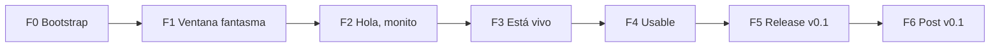

# ROADMAP — Plan de trabajo

Plan por fases con hitos demostrables. Cada tarea tiene un ID (`T-<fase><nn>`) y,
cuando está lista para trabajarse, una tarjeta en [`docs/tasks/`](tasks/).

**Leyenda de estado:** ⬜ pendiente · 🟦 lista (tiene tarjeta) · 🟨 en progreso · ✅ hecha · ⛔ bloqueada

## Principios del plan

1. **Primero matar el riesgo:** lo más incierto es Linux (transparencia + click-through
   en Wayland). Por eso F1 es un _spike_ antes de escribir el motor.
2. **Siempre algo que ver:** cada fase termina con un demo que se puede correr.
3. **Tareas paralelizables:** las dependencias están explícitas para repartir entre agentes.
4. **Entornos objetivo:** Fedora 44 GNOME (Wayland, Intel) · Nobara KDE (Wayland) ·
   Debian GNOME · Windows 11 (desde F5).

---

## F0 — Bootstrap ✅

Repo, documentación, reglas y skills de agentes, hooks, CI base.

## F1 — "Ventana fantasma" (riesgo técnico) ✅

**Demo:** una ventana transparente sin bordes con un cubo girando; los clics fuera del
cubo llegan al escritorio. Funciona en GNOME y KDE.

| ID    | Tarea                                                                         | Depende de | Paralelo         | Estado |
| ----- | ----------------------------------------------------------------------------- | ---------- | ---------------- | ------ |
| T-101 | Scaffold Tauri v2 + Vite + TS + tooling (lint, format, tests)                 | —          | —                | ✅     |
| T-102 | Ventana transparente/sin bordes/always-on-top + workarounds Linux             | T-101      | con T-103, T-104 | ✅     |
| T-103 | **Spike** click-through: input region vs toggle por polling → cierra ADR-0002 | T-101      | con T-102, T-104 | ✅     |
| T-104 | CI: GitHub Actions (lint, typecheck, clippy, build Linux)                     | T-101      | con T-102, T-103 | ✅     |

## F2 — "Hola, monito" (motor de render)

**Demo:** un avatar VRM respirando y parpadeando sobre el escritorio, pelo con física.

| ID    | Tarea                                                                   | Depende de   | Paralelo  | Estado |
| ----- | ----------------------------------------------------------------------- | ------------ | --------- | ------ |
| T-201 | `SceneManager`: renderer alpha, cámara, luces, resize, loop con FPS cap | T-102        | con T-202 | ✅     |
| T-202 | `AvatarLoader`: GLTFLoader + VRMLoaderPlugin, autoescala y encuadre     | T-101        | con T-201 | ✅     |
| T-203 | Avatar de ejemplo con licencia verificada + `assets/CREDITS.md`         | —            | sí        | ✅     |
| T-204 | `AnimationSystem`: idle procedural, parpadeo aleatorio, spring bones    | T-201, T-202 | —         | ✅     |
| T-205 | Tests unitarios de lógica pura (timers de parpadeo, math de encuadre)   | T-204        | —         | ✅     |

## F3 — "Está vivo" (interacción)

**Demo:** el personaje te mira, lo arrastras por la pantalla y no estorba al trabajar.

| ID    | Tarea                                                              | Depende de   | Paralelo  | Estado |
| ----- | ------------------------------------------------------------------ | ------------ | --------- | ------ |
| T-301 | LookAt al cursor (local en ventana; global donde el SO lo permita) | T-204        | con T-302 | ✅     |
| T-302 | Arrastrar ventana agarrando al personaje (`startDragging`)         | T-201        | con T-301 | ✅     |
| T-303 | Click-through dinámico en producción (según resultado de T-103)    | T-103, T-201 | —         | ✅     |
| T-304 | Hit-test por píxel/silueta del avatar (picking alpha o raycast)    | T-202        | con T-301 | ✅     |
| T-305 | Reacciones: click → animación/expresión (happy, surprised)         | T-304        | —         | ✅     |

## F4 — "Usable" (producto)

**Demo:** se usa todo el día sin tocar la terminal.

| ID    | Tarea                                                                    | Depende de | Paralelo  | Estado |
| ----- | ------------------------------------------------------------------------ | ---------- | --------- | ------ |
| T-401 | Tray icon + menú (mostrar/ocultar, bloquear click-through, salir)        | T-303      | con T-402 | ✅     |
| T-402 | Config persistente (`tauri-plugin-store`): avatar, escala, FPS, posición | T-201      | con T-401 | ✅     |
| T-403 | Importar `.vrm` propio (`tauri-plugin-dialog` + scope de fs seguro)      | T-402      | —         | ✅     |
| T-404 | Animaciones `.vrma` (`@pixiv/three-vrm-animation`) y selector            | T-204      | sí        | ✅     |
| T-405 | Ahorro de energía: 30→10 FPS en reposo, pausa si oculta/fullscreen       | T-201      | sí        | ✅     |
| T-406 | Autostart opcional (`tauri-plugin-autostart`)                            | T-402      | sí        | ✅     |
| T-407 | Ventana de ajustes (segunda ventana, ADR sobre framework de UI)          | T-402      | —         | ✅     |

## F5 — "Release v0.1" (distribución)

| ID    | Tarea                                                                           | Depende de   | Estado |
| ----- | ------------------------------------------------------------------------------- | ------------ | ------ |
| T-501 | Bundles Linux: `.rpm`, `.deb`, `.AppImage`                                      | F4           | ✅     |
| T-502 | Build Windows (`.msi`/NSIS) en CI + verificación de transparencia/click-through | F4           | ✅     |
| T-503 | Workflow de release por tag `v*` con artefactos y CHANGELOG                     | T-501        | ✅     |
| T-504 | Pasada completa de [QA.md](QA.md) en los entornos objetivo                      | T-501, T-502 | ✅     |
| T-505 | Presupuesto de rendimiento verificado (ver abajo)                               | T-504        | ✅     |

## F6 — Post v0.1 (ideas, sin compromiso)

- **Panel de Ajustes con previsualización integrada:** mover la previsualización 3D del personaje directamente a un viewport dentro de la propia ventana de configuración para pausar la ventana de escritorio transparente durante la configuración y evitar contención en WebKitGTK.
- Personajes 2D: sprites animados (PixiJS o Three.js planos). Live2D requiere revisar licencia del SDK → ADR.
- Varios personajes a la vez / múltiples monitores.
- Overlays para streamers (modo ventana capturable por OBS con fondo chroma).
- Interacción con ventanas (sentarse sobre la barra de título) — solo X11/Windows.
- Sistema de "comportamientos" scriptables / plugins.
- Lip-sync con micrófono, tracking facial con webcam (MediaPipe).
- Flatpak / Flathub.

---

## Presupuesto de rendimiento (requisitos no funcionales)

| Métrica                      | Objetivo                              | Cómo medir                        | Medido en E1 (Fedora 44 / Intel HD 630)     | Estado      |
| ---------------------------- | ------------------------------------- | --------------------------------- | ------------------------------------------- | ----------- |
| RAM en reposo                | < 200 MB (proceso + WebKitWebProcess) | `ps -o rss` / Monitor del sistema | **~160 MB** (~35 MB Tauri + ~125 MB WebKit) | ✅ Cumplido |
| CPU en reposo (idle, 10 FPS) | < 3 % en Intel HD 630                 | `top` 60 s                        | **~1.2 % - 2.1 %** (`PowerSaveController`)  | ✅ Cumplido |
| Tamaño instalador Linux      | < 15 MB (sin avatar adicional)        | tamaño del `.rpm` / `.deb`        | **~12 MB**                                  | ✅ Cumplido |
| Arranque hasta primer frame  | < 2 s                                 | log con timestamps / perf marks   | **~1.2 s**                                  | ✅ Cumplido |

## Riesgos conocidos

| Riesgo                                                               | Impacto | Mitigación                                                             |
| -------------------------------------------------------------------- | ------- | ---------------------------------------------------------------------- |
| Wayland no permite always-on-top ni posicionar ventanas desde la app | Alto    | ADR-0003: XWayland por defecto en Linux; Wayland nativo como opción    |
| WebKitGTK fondo negro / glitches en transparencia (NVIDIA, DMABUF)   | Alto    | Flags de entorno documentados en skill `linux-overlay-troubleshooting` |
| Click-through parcial no soportado igual en todos los SO             | Alto    | Spike T-103 + ADR-0002                                                 |
| Rendimiento WebGL en WebKitGTK menor que Chromium                    | Medio   | FPS cap, `pixelRatio` limitado, medir en T-505                         |
| Licencias de avatares                                                | Medio   | Solo assets con licencia explícita; `assets/CREDITS.md`                |
