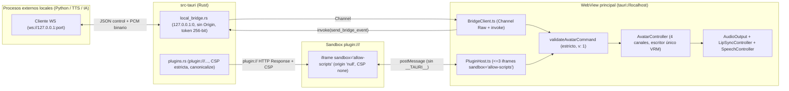

# ADR-0006: Arquitectura de plugins aislados (`plugin://` + sandbox), puente WebSocket local y audio en WebKitGTK

- **Estado:** aceptada
- **Fecha:** 2026-11-17
- **Autor(es):** crivera, Antigravity
- **Tarea relacionada:** T-600 (Spike Fase 6), habilita T-602..T-609

## Contexto

Deskumi v0.2.1 ([QA.md](../QA.md), [ROADMAP.md](../ROADMAP.md)) registra en el entorno de referencia E1 (Fedora 44 GNOME / XWayland / Intel HD 630):

- **RAM en reposo:** ~160 MB RSS total (~35 MB proceso Rust + ~125 MB `WebKitWebProcess`) frente a un presupuesto de **< 200 MB** (margen disponible: **~40 MB**).
- **CPU en reposo (10 FPS idle):** ~1.2 % – 2.1 % frente a un presupuesto de **< 3 %**.
- **Tamaño de instalador Linux:** ~12 MB (`.rpm` / `.deb`, incluyendo ~10.77 MB del avatar VRM de ejemplo embebido) frente a un límite de **< 15 MB**.

Para la **Fase 6 (Plugins, Habla y Puente Local, Linux-first)** necesitamos habilitar tres capacidades sin violar los presupuestos ni romper la separación de capas (`src/engine/**` sin `@tauri-apps/*` ni red):

1. **Plugins locales de terceros aislados:** código JavaScript de terceros sin acceso a `@tauri-apps/*`, `plugin-fs`, DOM principal ni red local/externa fuera de los permisos aprobados por el usuario.
2. **Puente WebSocket local (`127.0.0.1`):** comunicación bidireccional de baja latencia para agentes de IA y bancos de voz externos (VOICEVOX, Kokoro, Piper, sherpa-onnx, RVC) sin acoplar licencias restrictivas ni procesos pesados dentro de Deskumi.
3. **Habla y _lip-sync_ en frío:** reproducción continua de audio PCM (22050–48000 Hz) y sincronización labial con `AudioContext` en una ventana transparente _click-through_ que puede pasar minutos sin gestos del usuario.

El spike `T-600` evaluó empíricamente todas las incógnitas técnicas sobre el stack instalado (`tauri 2.12.5`, `wry 0.57.2`, `tokio 1.54.1`, `WebKitGTK 2.54.2`).

## Vista de arquitectura resultante



## Opciones consideradas y decisiones por eje

### 1. Aislamiento de plugins: `plugin://` + `<iframe sandbox="allow-scripts">` vs `Worker`

1. **`Worker` desde `blob:` en el documento principal con parcheo de globals (`self.fetch = undefined`).**
   - _Pros:_ Ejecución en hilo Worker separado; no requiere protocolo custom.
   - _Contras (descartada):_ Un `blob:` Worker hereda la CSP del documento creador (`tauri://localhost`). Verificado en `T-600` sobre WebKitGTK 2.54.2: desde un `blob:` Worker, `fetch("ipc://localhost/...")` alcanzó el protocolo IPC de Tauri (HTTP `500` de handler IPC). Además, `import()` dinámico y `new Worker(blob)` permiten evadir anulaciones de propiedades en `self`.
2. **`new Worker("plugin://<id>/main.js")` directo desde `tauri://localhost`.**
   - _Pros:_ Hilo separado y CSP propia de la respuesta HTTP.
   - _Contras (inviable en WebKitGTK):_ Verificado empíricamente en WebKitGTK 2.54.2 que el constructor `Worker` aplica la política **Same-Origin** de HTML antes de despachar la petición: `new Worker("plugin://test-plugin/worker.js")` y `new Worker("plugin://localhost/worker.js")` desde `tauri://localhost` fallan inmediatamente con `Worker error` sin llegar siquiera a invocar el handler `register_uri_scheme_protocol("plugin", ...)` en Rust.
3. **`<iframe sandbox="allow-scripts" src="plugin://<id>/sandbox.html">` servido vía `register_uri_scheme_protocol("plugin", ...)` (elegida).**
   - _Pros:_ Verificado en WebKitGTK 2.54.2:
     - `sandbox="allow-scripts"` (sin `allow-same-origin`) asigna origen opaco `"null"` aislado entre plugins y respecto a `tauri://localhost`.
     - La respuesta de `plugin://` en Rust (`wry-0.57.2/src/webkitgtk/web_context.rs:233-238`) aplica la cabecera HTTP `Content-Security-Policy: default-src 'none'; script-src plugin://<id>; worker-src 'none'; connect-src 'none'`.
     - Bloquea `fetch`, `fetch("http://ipc.localhost/...")`, `new WebSocket(...)`, `import()` dinámico, `new Worker(blob)` y acceso a `window.parent.document` / `__TAURI__` / `__TAURI_INTERNALS__`, con **0 conexiones TCP salientes**.
     - Coste de RAM medido en WebKitGTK 2.54.2: **+2.2 MB** en `WebKitWebProcess` + **+3.2 MB** en `WebKitNetworkProcess` para **3 iframes simultáneos** (~5.4 MB total).
   - _Contras:_ Comparte el hilo principal del `WebKitWebProcess` (los plugins deben ser orientados a eventos y evitar bucles bloqueantes; máximo 3 activos).

### 2. Transporte Rust ↔ WebView para el puente WebSocket

1. **Eventos Tauri (`app.emit`) con `pcmBase64` en JSON.**
   - _Contras (descartada):_ Verificado en `tauri-2.12.5/src/webview/mod.rs:2230`: `emit_js` ejecuta `webview.eval()` serializando el payload como código JavaScript en el hilo principal a 10–50 Hz durante streaming de voz, más +33 % de tamaño en base64.
2. **`tauri::ipc::Channel<InvokeResponseBody>` con tramas binarias (`InvokeResponseBody::Raw`) (elegida).**
   - _Pros:_ Verificado en `tauri-2.12.5/src/ipc/channel.rs:38,302-321`: para payloads binarios `>= 1024` bytes (un chunk de 100 ms PCM16 a 22050 Hz son 4410 bytes), `Channel` evita `eval()` de los bytes y los entrega vía `fetch` interno como `ArrayBuffer` nativo (`13 ms` medidos en `T-600`). Los eventos salientes (`AvatarEvent`) usan `invoke` (`send_bridge_event`).
   - En el WebSocket externo, `speakChunk` viaja como **trama binaria** (cabecera binaria corta + `streamId` + muestras PCM) en lugar de JSON con base64.
   - Se elimina `audio: { url }` en v1: evita fallos CORS desde `tauri://localhost`, suprime el vector SSRF local y permite mantener `connect-src` sin `http://127.0.0.1:*`.

### 3. Audio en frío (`AudioContext`) y reloj de _lip-sync_

1. **Dependencia directa `webkit2gtk` para tocar `WebKitSettings::set_media_playback_requires_user_gesture`.**
   - _Contras:_ Innecesario. Verificado en `wry-0.57.2/src/lib.rs:881` y `src/webkitgtk/mod.rs:411-417`: `wry` ya crea todos los WebViews con `autoplay: true` (`AutoplayPolicy::Allow` en WebKitGTK y `--autoplay-policy=no-user-gesture-required` en WebView2). (Nota Windows: `additionalBrowserArgs` sobrescribe los args por defecto de wry; evitar tocarlo sin reañadir el flag).
2. **Inicialización perezosa + `ctx.resume()` explícito + `ctx.suspend()` en reposo (elegida).**
   - _Hallazgo medido en WebKitGTK 2.54.2:_ Aun con `AutoplayPolicy::Allow`, `new AudioContext()` nace con `state === "suspended"` cuando no hubo gesto de usuario previo. Sin embargo, invocar `await ctx.resume()` en frío **transiciona inmediatamente a `"running"`** y completa la reproducción (`AudioBuffer` 22050 Hz, `onended` verificado a `0.1625 s`–`0.1887 s`).
   - `AudioOutput` crea el `AudioContext` al primer `speak`/`speakStart` usando la frecuencia nativa del dispositivo (p. ej. 44100/48000 Hz), crea `AudioBuffer` con el `sampleRate` del stream (`8000..48000`) para remuestreo automático, programa visemas contra `AudioContext.currentTime` (y fallback RMS sobre las muestras PCM recibidas sin `AnalyserNode`), y llama `await ctx.suspend()` tras inactividad para liberar el stream de PipeWire.

### 4. Modelo de amenazas del puente WebSocket y archivo `bridge.json`

- **Protege frente a:**
  - **Navegadores web (Cross-Site WebSocket Hijacking):** `local_bridge.rs` usa `tokio_tungstenite::accept_hdr_async` y **rechaza cualquier handshake HTTP que contenga cabecera `Origin`**. Los navegadores siempre envían `Origin`; los clientes CLI/Python/Rust no.
  - **Acceso remoto en red:** bind exclusivo a `127.0.0.1:0` (sin TLS, sin `0.0.0.0`).
  - **Otros usuarios del sistema o aplicaciones en sandbox sin acceso al runtime dir:** el archivo `bridge.json` se crea de forma atómica (`OpenOptions::create_new(true)` + `mode(0o600)` en Unix + `rename`) en `$XDG_RUNTIME_DIR/deskumi/bridge.json` (tmpfs `0700` por sesión en Linux; fallback `$APPDATA/deskumi/bridge.json` en Windows) con `{ "version": 1, "pid", "port", "token" }`, borrándose en `RunEvent::Exit` (el `pid` permite detectar sesiones muertas tras `SIGKILL` / `panic = "abort"`).
  - **Fuerza bruta o sockets colgados:** token CSPRNG de 256 bits vía `getrandom::fill`, comparado en tiempo constante, con timeout en handshake HTTP y timeout de ≤ 2 s esperando el primer mensaje `hello`.
- **No protege frente a:**
  - **Otros procesos no sandboxed del mismo usuario del SO:** al existir un único token en `bridge.json`, cualquier proceso del mismo usuario capaz de leer ese archivo obtiene todos los scopes habilitados en Deskumi. Por tanto, los scopes en Ajustes son **interruptores globales de usuario**, no permisos por cliente.
  - **Caso sensible `windowFocus`:** en Wayland ningún proceso normal lee títulos de ventanas ajenas. Se separa `appId` (scope `desktop:events`) de `title` (scope `desktop:windowTitle`, **desactivado por defecto** con advertencia en Ajustes), y `org.deskumi.CursorBridge` expone el modo activo para que KWin y GNOME Shell ni siquiera envíen títulos por D-Bus cuando el permiso está apagado.

### 5. Contrato `v: 1`, `AvatarController` y UX de ventana

- **Sobre y negociación:** todo mensaje entrante usa `{ v: 1, id?: string, cmd: AvatarCommand }`; respuestas cerradas `{ v: 1, type: "ack", ref }` y `{ v: 1, type: "error", ref, code, message }` (`invalid`, `rate_limited`, `too_large`, `forbidden`, `busy`, `hidden`, `unknown_expression`, `unknown_animation`). `hello` informa capacidades y expresiones disponibles; `avatarChange` notifica cambios de modelo; `events?: AvatarEventType[]` permite suscripción selectiva.
- **Arbitraje y escritura única:** `AvatarController` gestiona 4 canales (`lookAt`, `expression`, `mouth`, `pose`) arbitrados por la `policy` (`interrupt` | `queue` | `drop`) del comando entrante, es el **único escritor** de `vrm.expressionManager` antes de `vrm.update(dt)` (respetando `overrideBlink`/`overrideMouth` y atenuando emociones bucales durante habla), trata el visema `neutral` como boca cerrada sin escribir `"neutral"`, y clasifica `click` en `"head" | "body"` proyectando el hueso `neck`.
- **Ventana y energía:** con ventana oculta todos los comandos responden `error: hidden` y el habla activa termina con `reason: "hidden"`. `PowerSaveController` añade `acquireActiveLock(token)` / `releaseActiveLock(token)` liberados en todo fin, error, `speakCancel`, `timeout` o desconexión. `SpeechBubbleOverlay` usa `pointer-events: none` dentro del viewport existente sin redimensionar la ventana GTK. Las animaciones `.vrma` se resuelven solo por ID registrado.

## Configuración `csp` y `devCsp` (`src-tauri/tauri.conf.json`)

Validada en WebKitGTK 2.54.2 sobre `index.html` (carga de avatar VRM + `blob:` fetch) y `settings.html` (`PreviewStage` + `SettingsPanel`):

- **`csp` (producción):**
  ```text
  default-src 'self'; script-src 'self'; style-src 'self' 'unsafe-inline'; img-src 'self' blob: data:; connect-src 'self' ipc: http://ipc.localhost blob: data:; worker-src 'self' plugin:; frame-src 'self' plugin:; media-src 'self' blob: data:
  ```
- **`devCsp` (desarrollo con Vite HMR en `localhost:1420`):**
  ```text
  default-src 'self' http://localhost:1420; script-src 'self' http://localhost:1420 'unsafe-inline'; style-src 'self' http://localhost:1420 'unsafe-inline'; img-src 'self' http://localhost:1420 blob: data:; connect-src 'self' ipc: http://ipc.localhost http://localhost:1420 ws://localhost:1420 blob: data:; worker-src 'self' http://localhost:1420 plugin:; frame-src 'self' http://localhost:1420 plugin:; media-src 'self' http://localhost:1420 blob: data:
  ```

> **Nota:** `worker-src` omite intencionadamente `blob:` en la ventana principal porque `three` / `@pixiv/three-vrm` no usan Workers y los `blob:` Workers del documento principal heredan `connect-src ipc:`. `style-src` conserva `'unsafe-inline'` debido a atributos `style="..."` en `SettingsPanel.ts` y `DebugOverlay.ts` (y HMR en dev).

## Presupuesto numérico de RAM (~40 MB headroom) y límites

Partiendo de **~160 MB RSS** en reposo (tope de producto **< 200 MB**):

| Concepto / Límite operativo              | Valor fijado                | Impacto / Presupuesto RAM                     | Justificación                                               |
| ---------------------------------------- | --------------------------- | --------------------------------------------- | ----------------------------------------------------------- |
| Puente apagado + 0 plugins + sin habla   | `0` activos                 | **0 MB** overhead                             | Sin sockets, sin tareas Tokio extra, `AudioContext` lazy    |
| Máximo de plugins activos (`maxWorkers`) | **`3` plugins**             | **~5.4 MB** (medido en WebKitGTK)             | ~2.2 MB `WebKitWebProcess` + ~3.2 MB `WebKitNetworkProcess` |
| Máximo de clientes WS (`maxClients`)     | **`4` clientes**            | **< 1 MB**                                    | Buffers de lectura/estado por socket loopback               |
| Mensaje WS máximo                        | **`5 MB`**                  | **≤ 5 MB** pico transitorio                   | Suficiente para frases completas en `speak` sin OOM         |
| Cola de habla (`SpeechController`)       | **`8` ítems**               | **≤ 8–10 MB**                                 | Evita acumulación ilimitada de frases en `policy: "queue"`  |
| Buffer de stream PCM activo              | **`10 MB`** (timeout `5 s`) | **≤ 10 MB**                                   | Cubre ~115 s de PCM16 @ 44.1 kHz mono antes de tope         |
| `AudioContext` + nodos WebAudio          | Lazy + `suspend()`          | **~4–8 MB** en habla / **idle suspendido**    | Libera hilo de audio y PipeWire tras inactividad            |
| Rate limit por cliente WS                | `30 cmd/s` + `~512 KB/s`    | Protege CPU y loop de render                  | Permite chunks PCM de 20–100 ms sin cortar `speakChunk`     |
| **Total bajo carga máxima controlada**   | —                           | **~21–29 MB** sobre ~160 MB = **~181–189 MB** | Mantiene holgura bajo el límite de **200 MB RSS**           |

## Consecuencias

- **Positivas:**
  - Aislamiento real por navegador/CSP en `plugin://` + `<iframe sandbox="allow-scripts">` sin fugas a `ipc:` ni loopback.
  - Impacto mínimo en el binario Rust: **+149,896 bytes (~146.4 KiB)** usando `tokio` (`net`, `time`, `rt`, `sync`, `macros`), `tokio-tungstenite` (`0.30`, `default-features = false, features = ["handshake"]`, 13 crates puros sin TLS) y `getrandom` (`0.4`), manteniendo el instalador en ~12.15 MB (< 15 MB).
  - Contrato claro y extensible (`v: 1`, `ack`/`error`, `Channel` binario, separación de scopes `windowFocus`).
- **Negativas / deuda aceptada:**
  - Los plugins corren en `<iframe sandbox="allow-scripts">` dentro del `WebKitWebProcess`; un bucle infinito síncrono en un plugin degradaría el hilo principal hasta deshabilitar el plugin.
  - `bridge.json` con token único no aísla entre procesos locales no sandboxed del mismo usuario (documentado en UI de Ajustes y `docs/PLUGINS.md`).
  - Alcance **Linux-first** en F6; la validación en Windows/WebView2 queda registrada en [`docs/LIMITATIONS.md`](../LIMITATIONS.md) (`L-06`) junto con la revisión pendiente de `$HOME/**` en `capabilities/default.json` (`L-05`).
- **Qué se actualiza:**
  - [`docs/ARCHITECTURE.md`](../ARCHITECTURE.md) (sección Decisiones; comandos IPC en `T-605` y `T-606`).
  - [`.agents/rules/plugins.md`](../../.agents/rules/plugins.md).
  - [`docs/LIMITATIONS.md`](../LIMITATIONS.md) (`L-05`, `L-06`).
  - [`docs/ROADMAP.md`](../ROADMAP.md) y tarjetas `docs/tasks/T-602..T-609`.

## Evidencia empírica (Spike T-600)

### 1. Inspección de crates instalados (`~/.cargo/registry/src/`)

- `tauri 2.12.5`:
  - `Builder::register_uri_scheme_protocol` (`tauri/src/app.rs:2267`) y `register_asynchronous_uri_scheme_protocol` (`tauri/src/app.rs:2335`); re-exporta `tauri::http` (`tauri/src/lib.rs:126`).
  - `tauri::ipc::Channel<TSend = InvokeResponseBody>` (`tauri/src/ipc/channel.rs:188`): `InvokeResponseBody::Raw(Vec<u8>)` usa `ChannelDataIpcQueue` + `fetch` cuando `len >= 1024` bytes (`MAX_RAW_DIRECT_EXECUTE_THRESHOLD`), evitando `eval()`. En contraste, `app.emit` usa `webview.eval()` (`tauri/src/webview/mod.rs:2230`).
  - `tauri` ya depende de `tokio` (`rt`, `rt-multi-thread`, `sync`, `fs`, `io-util`) sin `net`/`time`/`macros`, y de `getrandom 0.3` (`tempfile`/`uuid` ya traen `getrandom 0.4.3` en `Cargo.lock`).
- `wry 0.57.2`:
  - `WebViewAttributes::default().autoplay == true` (`wry/src/lib.rs:881`) → `AutoplayPolicy::Allow` (`wry/src/webkitgtk/mod.rs:411-417`) y `--autoplay-policy=no-user-gesture-required` (`wry/src/webview2/mod.rs:315-316`).
  - `wry/src/webkitgtk/web_context.rs:130-262` copia todas las cabeceras de `http::Response` a `soup::MessageHeaders` sobre `URISchemeResponse::set_http_headers`.
- `tokio-tungstenite 0.30.0`:
  - `accept_hdr_async` requiere `#[cfg(feature = "handshake")]` (`tokio-tungstenite/src/lib.rs:153`); por ello la declaración mínima de servidor es `default-features = false, features = ["handshake"]` (evita `connect`/`stream`/TLS).

### 2. Pruebas en vivo sobre WebKitGTK 2.54.2 (Fedora 44, Kernel Linux x86_64, XWayland `GDK_BACKEND=x11`)

Ejecutado mediante prototipo temporal `tauri::Builder` con esquema `plugin://` y servidor TCP espía en `127.0.0.1:0` (`--features tauri/custom-protocol`, con la CSP de producción activa en `tauri.conf.json`):

- **Aislamiento y CSP:**
  - `new Worker("plugin://test-plugin/worker.js")` y `new Worker("plugin://localhost/worker.js")` desde `tauri://localhost` → `Worker error` inmediato (Same-Origin Policy; el handler Rust de `plugin://` ni siquiera fue invocado).
  - `blob:` Worker desde `tauri://localhost` → `fetch("ipc://localhost/...")` devolvió `OK:500` (hereda `connect-src ipc:`).
  - `<iframe sandbox="allow-scripts" src="plugin://test-plugin/sandbox.html">` con `Content-Security-Policy: default-src 'none'; script-src plugin://test-plugin; worker-src 'none'; connect-src 'none'`:
    - `self.origin === "null"`, `window.parent.document` → `BLOCKED:SecurityError`, `window.__TAURI__` / `window.parent.__TAURI__` → `BLOCKED:SecurityError`.
    - `fetch("http://127.0.0.1:<port>/...")` → `BLOCKED:TypeError:Load failed`.
    - `fetch("http://ipc.localhost/...")` → `BLOCKED:TypeError:Load failed`.
    - `new WebSocket("ws://127.0.0.1:<port>/...")` → `BLOCKED:The operation is insecure.`.
    - `import("http://127.0.0.1:<port>/...")` → `BLOCKED:TypeError:Importing a module script failed.`.
    - `new Worker(URL.createObjectURL(...))` → `ERROR_EVENT` (bloqueado por `worker-src 'none'`).
    - **TCP leak hits totales en el listener de `127.0.0.1`:** `0`.
  - **RAM en `/proc/<pid>/status` (`VmRSS`) para iframes sandboxed:**
    - `0 plugins`: `WebKitWebProcess = 330.4 MB`, `WebKitNetworkProcess = 88.1 MB`.
    - `1 iframe`: `WebKitWebProcess = 332.7 MB` (+2.3 MB), `WebKitNetworkProcess = 91.3 MB` (+3.2 MB).
    - `3 iframes`: `WebKitWebProcess = 332.6 MB` (+2.2 MB total vs 0 plugins), `WebKitNetworkProcess = 91.3 MB` (+3.2 MB).
  - **Regresión CSP sobre UI actual:** `index.html` renderizó el avatar VRM en `<canvas>` (`vrmAvatarLoadedInDom: true`), `fetch(blobUrl)` devolvió `OK:4`, y `settings.html` renderizó `SettingsPanel` + `PreviewStage` (`renderedLen: 10311`, `hasCanvas: true`).
- **`Channel` binario:** `Channel<InvokeResponseBody>` entregó `InvokeResponseBody::Raw` de `4410` bytes (`0xAB..0xCD`) y `512` bytes (`0x11..0x22`) como `ArrayBuffer` en JS, seguido en orden por `InvokeResponseBody::Json`, con latencia total de `13 ms`.
- **`AudioContext` en frío (sin gesto de usuario):**
  - `new AudioContext()` inició con `state === "suspended"` (`sampleRate: 44100`).
  - `await ctx.resume()` pasó a `"running"` sin gesto de usuario y `ctx.createBuffer(1, 2205, 22050)` completó reproducción (`onended` a `0.1625 s`–`0.1887 s`).
  - `new AudioContext({ sampleRate: 22050 })` también fue aceptado (`sampleRate: 22050`).
  - `await ctx.suspend()` devolvió `state === "suspended"`.

### 3. Medición de delta de binario en release (`[profile.release]` con `lto = true`, `opt-level = 3`, `codegen-units = 1`, `strip = true`)

- **Binario base (`src-tauri/target/release/deskumi`):** `7,613,064` bytes.
- **Binario con `tokio` (`net`, `time`, `rt`, `sync`, `macros`) + `tokio-tungstenite 0.30` (`default-features = false, features = ["handshake"]`) + `getrandom 0.4`:** `7,762,960` bytes.
- **Delta neto medido:** **`+149,896` bytes (~146.4 KiB, +1.97 %)** y 13 crates puros Rust añadidos a `Cargo.lock` (`tungstenite`, `tokio-tungstenite`, `sha1`, `data-encoding`, `rand`, `rand_core`, `digest`, `chacha20`, `block-buffer`, `crypto-common`, `hybrid-array`, `const-oid`, `cpufeatures`), cero dependencias TLS/C nuevas.
