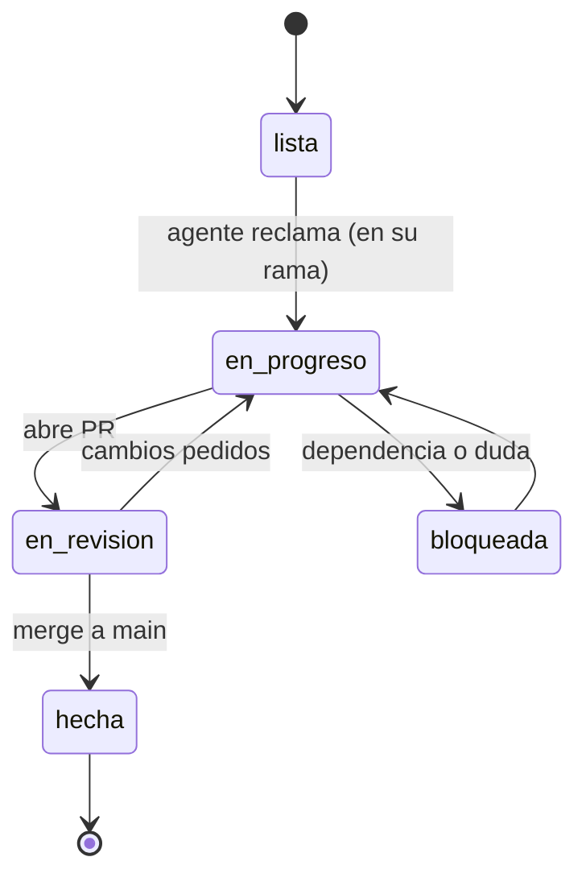

# Tarjetas de tareas

Cada archivo `T-XXX-*.md` es una unidad de trabajo para **un agente, una rama, un PR**.
Solo existen tarjetas para tareas "listas" (🟦 en el [ROADMAP](../ROADMAP.md)); las
demás se detallan cuando se acerca su fase (usa la skill `task-workflow` → "Crear tarjeta").

## Ciclo de vida

## Plantilla
Copia [`_TEMPLATE.md`](_TEMPLATE.md).
